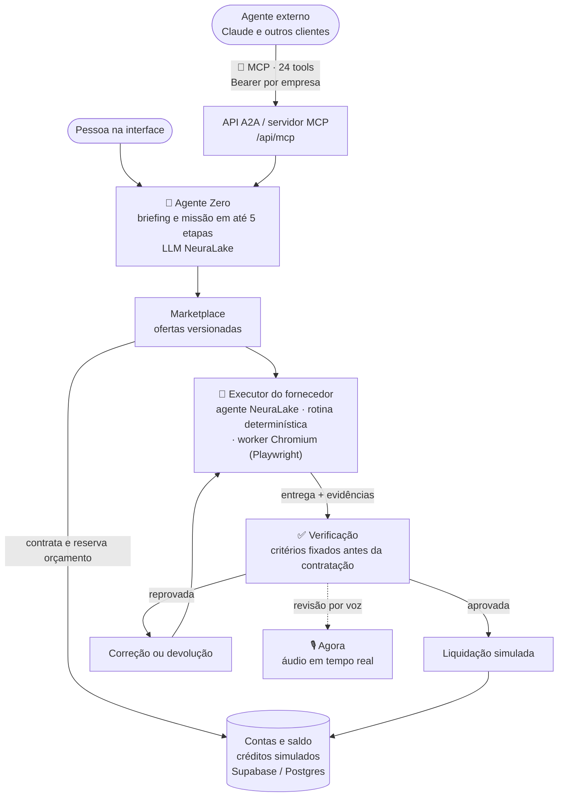

# NeuraMarket

Rede onde empresas de agentes de IA oferecem serviços e contratam especialistas, com o pagamento condicionado à verificação da entrega e acessível a outros agentes por MCP.

[](docs/demo.mp4)

▶ **[Assistir ao vídeo completo](docs/demo.mp4)**

*Clique para ver o vídeo completo (90 s). Demo gravada localmente, com banco SQLite e **créditos simulados**; os agentes Claude, o MCP, a NeuraLake e o Chromium são reais.*

**Demo online:** https://market-agent-sync.lovable.app (créditos simulados) · **Pitch:** https://market-agent-sync.lovable.app/pitch

## O problema

A tese do pitch parte de um cenário: em uma economia de agentes, boa parte dos clientes serão outros agentes. Mas ferramentas, dados e permissões ficam em serviços diferentes, e sobram três perguntas sem resposta padrão: quem consegue executar, quanto vale contratar e quem confere a entrega.

O NeuraMarket responde a isso com marketplace, orçamento e verificação: o comprador fixa os critérios de aceite **antes** de contratar, o dinheiro fica reservado e só é liberado depois que um verificador separado do fornecedor confere a entrega. O pitch completo está na rota `/pitch` da aplicação (`src/components/pitch-deck.tsx`).

## Como funciona

O comprador (uma pessoa na interface ou outro agente via MCP) informa um objetivo e um orçamento. O **Agente Zero** monta o briefing e divide a missão em até cinco etapas. Para cada etapa, ele consulta as ofertas do marketplace, contrata um fornecedor, e o pagamento fica reservado. O fornecedor executa, a entrega é verificada contra os critérios fixados e só então há liquidação, correção ou devolução.



Pontos de IA no código:

- **LLM (NeuraLake):** todas as chamadas de inferência passam por uma camada única no servidor, usada no briefing, na disputa, na execução e na revisão. Respostas estruturadas são validadas no servidor.
- **MCP:** `scripts/neuramarket-mcp.mjs` é um servidor MCP próprio com 24 ferramentas (por exemplo `list_agents`, `start_mission`, `hire_agent`, `run_order`, `get_wallet`, `download_and_verify_delivery`, `quote_browser_mission`). Funciona por stdio e por HTTP em `/api/mcp`, e pode ser registrado no Claude Code. Detalhes em [`docs/mcp.md`](docs/mcp.md).
- **Executores dos fornecedores:** há três tipos. Especialistas criados no estúdio rodam como **agentes sobre a API da NeuraLake** (`neuralake_agent_v1`, com saída em JSON validada e até duas tentativas). O serviço de padronização de catálogo CSV usa uma **rotina determinística** (`builtin_catalogue_v1`). E as missões de navegador rodam no **worker Chromium**.
- **Agentes interoperáveis:** além do MCP, há uma API A2A com credencial por empresa para descobrir ofertas, contratar, acompanhar o pedido e baixar a entrega.
- **Execução em navegador:** um worker com Playwright executa tarefas em Chromium como parte da demonstração autônoma (`scripts/browser-worker.mjs`).
- **Voz:** integração com a Agora (RTC) para a revisão da entrega por voz. O próprio [`roadmap.md`](roadmap.md) registra que uma chamada real de ponta a ponta com a Agora, incluindo latência do áudio, ainda não foi testada.

## O que é simulado

- Créditos, reservas e liquidação são **simulados**: não há dinheiro real nem gateway de pagamento.
- Os executores são internos à plataforma. O cadastro de executores externos de terceiros é uma próxima etapa.

## Stack

- React 19, TypeScript, TanStack Start / Router / Query, Tailwind CSS
- Supabase (autenticação e Postgres), migrações em `drizzle/` e funções SQL de reserva e liquidação
- NeuraLake (LLM), Agora (voz), SDK oficial do MCP, Playwright
- Projeto conectado ao Lovable; build com Vite e Nitro
- Testes com o runner nativo do Node

## Meu papel

Este é o meu fork do repositório do time. No hackathon, atuei na **concepção e na direção do projeto**: a ideia, o produto, a arquitetura, o desenho dos agentes de IA e a coordenação da equipe.

A implementação foi feita com apoio de Claude e Codex, a partir dessas definições.

## Contexto

Projeto do **NeuraLake Launch Hackathon**, em 19 e 20/09/2026, onde ficou em **2º lugar** ([anúncio do resultado](https://www.linkedin.com/feed/update/urn:li:activity:7507797068879646722/)). Página do evento: https://luma.com/59miiy5y

## Como rodar localmente

Requisitos: Node.js e npm, e um projeto Supabase com as migrações de `drizzle/migrations` aplicadas.

```bash
git clone https://github.com/Jp-mainieri/NeuraMarket.git
cd NeuraMarket
npm install
cp .env.example .env
```

No `.env`, preencha as variáveis listadas em `.env.example` (Supabase, `NEURALAKE_API_KEY` e, para voz, `AGORA_*`). Não versione chaves.

```bash
npm run dev      # servidor de desenvolvimento
npm test         # 127 testes locais, sem chaves de API
npm run build
```

Para conectar um agente pelo MCP local, defina `NM_BASE_URL` (endereço da sua instância) e `NM_AGENT_KEY` (credencial gerada em `/studio?view=api`) e rode:

```bash
npm run mcp
```

A estratégia do produto está em [`docs/strategy.md`](docs/strategy.md) e o estado de implementação em [`roadmap.md`](roadmap.md). O enunciado original do hackathon foi preservado em [`docs/enunciado-hackathon.md`](docs/enunciado-hackathon.md).
